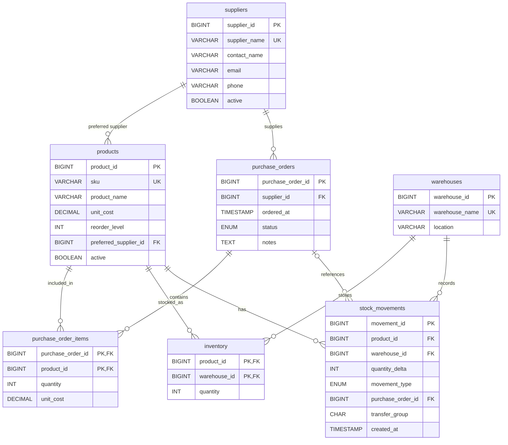

# Inventory and Warehouse Management System

A MySQL-based inventory and warehouse management database that tracks products, suppliers, warehouses, current stock, and stock movement history. It uses SQL constraints, triggers, a view, and reporting queries to help maintain consistent inventory records across multiple warehouses.

## Features

- Maintain supplier, product, and warehouse records.
- Track stock separately for each product in each warehouse.
- Record receipts, sales, adjustments, and warehouse transfers.
- Automatically update inventory balances when stock movements are inserted.
- Prevent stock movements that would make inventory negative.
- Protect the stock movement history from updates and deletes.
- Identify low-stock products through the `reorder_list` view.
- Generate stock valuation and supplier-wise purchase reports.
- Include commented examples for CSV price import and stock report export.

## Technology

- **Database:** MySQL 8.0.16+
- **Storage engine:** InnoDB
- **Query language:** SQL
- **Database client used for execution:** MySQL Workbench or MySQL command line

## Database Schema

The database contains seven tables:

| Table | Purpose |
|---|---|
| `suppliers` | Stores supplier contact and status information. |
| `products` | Stores SKU, product details, unit cost, reorder level, and preferred supplier. |
| `warehouses` | Stores warehouse names and locations. |
| `inventory` | Stores the current quantity of each product at each warehouse. |
| `purchase_orders` | Stores purchase order headers and supplier references. |
| `purchase_order_items` | Stores the products, quantities, and unit costs in each purchase order. |
| `stock_movements` | Stores the history of receipts, sales, adjustments, and transfer entries. |

### Entity Relationship Diagram (ERD)

The following Mermaid ER diagram is rendered automatically by GitHub in this README.



**Key design notes**

- `inventory` uses a **composite primary key**: `(product_id, warehouse_id)`, so each product has one current-balance row per warehouse.
- `stock_movements` is the audit ledger. `quantity_delta` is positive for receipts and transfer-ins, and negative for sales and transfer-outs. Adjustments may be positive or negative.
- `transfer_group` is a shared UUID used to pair the two sides of a transfer; it is not a foreign key.
- The `reorder_list` view checks stock for each active product at each warehouse against that product's `reorder_level`.

## SQL Logic

### Triggers

Four triggers automate and protect inventory operations:

1. **`stock_movement_before_insert`** — creates an inventory row if needed, locks the relevant row, and rejects a movement if it would result in negative stock.
2. **`stock_movement_after_insert`** — applies the accepted `quantity_delta` to the current inventory balance.
3. **`stock_movement_before_update`** — prevents changes to existing stock movement records.
4. **`stock_movement_before_delete`** — prevents deletion of stock movement records.

To correct a historical entry, add a correcting adjustment instead of editing or deleting the original movement.

### View

- **`reorder_list`** — lists active products whose quantity on hand is below the reorder level at a warehouse, including a suggested reorder quantity and preferred supplier.

### Reports

The SQL script includes two report queries:

- **Stock value per warehouse:** calculates `quantity × unit_cost` and groups the result by warehouse.
- **Supplier-wise purchase totals:** calculates purchase value and total units ordered for open and received purchase orders.

## Setup and Execution

> Run this script in a fresh database. The `CREATE TABLE`, trigger, and view statements are not written as an idempotent migration.

### Option 1: MySQL Workbench

1. Install MySQL Server 8.0.16 or later.
2. Open MySQL Workbench and connect to your MySQL server.
3. Create and select a fresh database:

   ```sql
   CREATE DATABASE inventory_demo;
   USE inventory_demo;
   ```

4. Open the project SQL script in Workbench.
5. Execute the script.
6. Verify the tables and view:

   ```sql
   SHOW TABLES;
   SHOW TRIGGERS;
   SELECT * FROM reorder_list;
   ```

### Option 2: MySQL Command Line

Save the SQL script as `inventory_management.sql`, then run:

```bash
mysql -u root -p -e "CREATE DATABASE inventory_demo;"
mysql -u root -p inventory_demo < inventory_management.sql
```

Use your own MySQL username if it is not `root`.

## Sample Operations

### Record a sale

A sale is represented by a negative `quantity_delta`. The trigger updates the balance automatically and rejects the insert if stock would become negative.

```sql
INSERT INTO stock_movements
    (product_id, warehouse_id, quantity_delta, movement_type, note)
VALUES
    (1, 1, -3, 'sale', 'Sample sale');
```

### Transfer stock between warehouses

A transfer is represented by two movement records: a negative `transfer_out` at the source and a positive `transfer_in` at the destination. Use one transaction and a shared UUID.

```sql
START TRANSACTION;

SET @transfer_id = UUID();

INSERT INTO stock_movements
    (product_id, warehouse_id, quantity_delta, movement_type, transfer_group, note)
VALUES
    (1, 1, -5, 'transfer_out', @transfer_id, 'Central to East');

INSERT INTO stock_movements
    (product_id, warehouse_id, quantity_delta, movement_type, transfer_group, note)
VALUES
    (1, 2, 5, 'transfer_in', @transfer_id, 'Central to East');

COMMIT;
```

If either insert fails, issue `ROLLBACK` instead of `COMMIT`.

## CSV Examples

The SQL script contains commented examples for:

- **CSV import:** load supplier price data into a temporary staging table, match existing products by SKU, and update unit cost and reorder level.
- **CSV export:** write a warehouse stock valuation report using `SELECT ... INTO OUTFILE`.

These examples are not executed automatically. CSV import may require enabling `LOCAL INFILE` in the client/server configuration. CSV export writes to a server-side permitted directory and is subject to MySQL's `secure_file_priv` setting and file permissions. The example import reads `supplier_name` into the staging table but does not update the product's preferred supplier.

## Notes and Limitations

- The supplied SQL script seeds sample suppliers, products, warehouses, opening stock movements, and one purchase order.
- The transfer and CSV statements are examples in comments; run and configure them separately when needed.
- The sample CSV price update matches products by SKU and updates `unit_cost` and `reorder_level`.
- The schema uses MySQL features such as InnoDB triggers, `SIGNAL`, check constraints, and `SELECT ... FOR UPDATE`; use a compatible MySQL version.

## Project Structure

```text
.
├── inventory_management.sql
└── README.md
```

## Acknowledgement

This repository documents and demonstrates the supplied SQL implementation. If you use or adapt an existing public implementation, retain its original attribution and license information in the repository.
