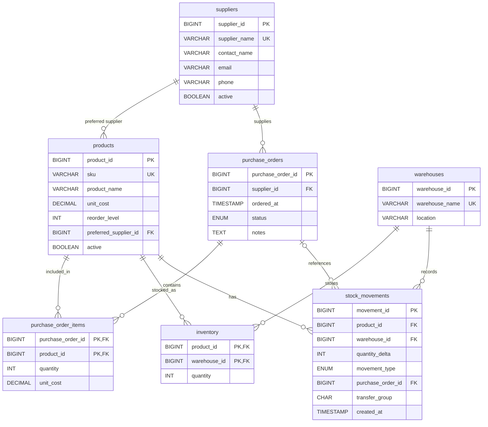

<div align="center">

# 📦 Inventory and Warehouse Management System
### MySQL Database Project

**A database-driven system for managing products, suppliers, warehouses, stock levels, and inventory movements.**


</div>

---

## 5.1 Problem Statement and Requirements

A business operating across multiple warehouses needs a reliable way to manage products, suppliers, purchase orders, and stock. The database must keep stock balances consistent, prevent sales that exceed available stock, preserve inventory movement history, and provide useful reports.

| ID | Requirement | Where it is solved |
|---|---|---|
| R1 | Store supplier information | `suppliers` |
| R2 | Store product details, SKU, cost, and reorder level | `products` |
| R3 | Store warehouse information | `warehouses` |
| R4 | Track stock by product and warehouse | `inventory` |
| R5 | Record receipts, sales, adjustments, and transfers | `stock_movements` |
| R6 | Update stock automatically and prevent negative inventory | MySQL triggers |
| R7 | Maintain purchase orders and their line items | `purchase_orders`, `purchase_order_items` |
| R8 | Identify low-stock products and generate reports | `reorder_list` view and report queries |
| R9 | Demonstrate warehouse transfers and CSV workflows | Commented SQL examples |

## 5.2 Data Model

The database contains seven tables. Suppliers can be associated with multiple products and purchase orders. A purchase order contains multiple product line items. Products can be stored in multiple warehouses, and each warehouse can store multiple products. The `inventory` table resolves this many-to-many relationship.

The `stock_movements` table records each stock change. Triggers use these records to update the current quantity in `inventory`.

### Entity Relationship Diagram (ERD)



**Relationship and key notes**

- `PK` = Primary Key; `FK` = Foreign Key; `UK` = Unique Key.
- `inventory` has a composite primary key: `(product_id, warehouse_id)`.
- `transfer_group` is a shared UUID used to associate the two movement records in a transfer. It is not a foreign key.
- `reorder_list` compares each active product's stock at each warehouse with its `reorder_level`.

### Table Reference

| Table | Purpose | Important keys and rules |
|---|---|---|
| `suppliers` | Supplier details | PK `supplier_id`; unique supplier name |
| `products` | Product catalogue and reorder settings | PK `product_id`; FK `preferred_supplier_id`; unique SKU; non-negative cost |
| `warehouses` | Warehouse names and locations | PK `warehouse_id`; unique warehouse name |
| `inventory` | Current stock by product and warehouse | Composite PK `(product_id, warehouse_id)`; both columns are FKs |
| `purchase_orders` | Purchase order header | PK `purchase_order_id`; FK `supplier_id`; status enum |
| `purchase_order_items` | Products in an order | Composite PK `(purchase_order_id, product_id)`; both columns are FKs |
| `stock_movements` | Stock change history | PK `movement_id`; FKs to product, warehouse, and optional purchase order |

## 5.3 Build It Step by Step

Run the SQL script in order. The complete implementation is supplied in `inventory_management.sql`.

### Step 1: Create the database and tables

The schema creates seven InnoDB tables. Parent tables are created before dependent tables so foreign-key references can be defined.

**SQL concepts used:** `PRIMARY KEY`, `AUTO_INCREMENT`, `FOREIGN KEY`, `UNIQUE`, `CHECK`, `DEFAULT`, `ENUM`, and InnoDB.

```sql
CREATE DATABASE inventory_demo;
USE inventory_demo;

-- Run the CREATE TABLE statements from inventory_management.sql
SHOW TABLES;
```

### Step 2: Understand the inventory structure

The `inventory` table stores the current balance for each product at each warehouse. Its composite primary key prevents duplicate balance rows for the same product and warehouse.

```sql
CREATE TABLE inventory (
    product_id BIGINT UNSIGNED NOT NULL,
    warehouse_id BIGINT UNSIGNED NOT NULL,
    quantity INT UNSIGNED NOT NULL DEFAULT 0,
    PRIMARY KEY (product_id, warehouse_id),
    FOREIGN KEY (product_id) REFERENCES products(product_id),
    FOREIGN KEY (warehouse_id) REFERENCES warehouses(warehouse_id)
) ENGINE=InnoDB;
```

### Step 3: Add sample master data

The SQL script inserts sample suppliers, products, and warehouses. Opening stock is entered as receipt movements so current inventory and movement history remain consistent.

```sql
SELECT * FROM suppliers;
SELECT * FROM products;
SELECT * FROM warehouses;

SELECT p.product_name, w.warehouse_name, i.quantity
FROM inventory i
JOIN products p ON p.product_id = i.product_id
JOIN warehouses w ON w.warehouse_id = i.warehouse_id
ORDER BY p.product_id, w.warehouse_id;
```

### Step 4: Create triggers (automatic stock control)

Four triggers are defined in the SQL script.

| Trigger | Event | Purpose |
|---|---|---|
| `stock_movement_before_insert` | BEFORE INSERT | Creates and locks the inventory row; rejects a movement that would make stock negative |
| `stock_movement_after_insert` | AFTER INSERT | Updates the current inventory quantity |
| `stock_movement_before_update` | BEFORE UPDATE | Prevents editing movement history |
| `stock_movement_before_delete` | BEFORE DELETE | Prevents deleting movement history |

The stock validation rule:

```sql
IF CAST(current_qty AS SIGNED) + NEW.quantity_delta < 0 THEN
    SIGNAL SQLSTATE '45000'
        SET MESSAGE_TEXT =
        'Insufficient stock: movement would make inventory negative';
END IF;
```

After a valid movement is inserted, the `AFTER INSERT` trigger applies the quantity change:

```sql
UPDATE inventory
SET quantity = quantity + NEW.quantity_delta
WHERE product_id = NEW.product_id
  AND warehouse_id = NEW.warehouse_id;
```

### Step 5: Record a stock movement

A sale is stored as a negative `quantity_delta`. The trigger checks available stock and updates the balance automatically.

```sql
INSERT INTO stock_movements
    (product_id, warehouse_id, quantity_delta, movement_type, note)
VALUES
    (1, 1, -3, 'sale', 'Sample sale');

SELECT *
FROM inventory
WHERE product_id = 1 AND warehouse_id = 1;
```

**Test result recorded in MySQL Workbench**

| Test | Result |
|---|---:|
| Starting stock | 60 |
| Sale quantity | -3 |
| Remaining stock | 57 |

An attempt to sell 1,000 units was rejected with **Error Code 1644**:

```text
Insufficient stock: movement would make inventory negative
```

This demonstrates the negative-stock validation trigger.

### Step 6: Create the low-stock view

The `reorder_list` view identifies active products whose stock is below their reorder level at a warehouse. It also calculates the suggested reorder quantity and displays the preferred supplier.

```sql
SELECT *
FROM reorder_list
ORDER BY warehouse_name, product_name;
```

### Step 7: Generate stock valuation report

Calculates the value of current stock in each warehouse using `quantity × unit_cost`.

```sql
SELECT
    w.warehouse_name,
    SUM(i.quantity * p.unit_cost) AS stock_value
FROM inventory i
JOIN products p ON p.product_id = i.product_id
JOIN warehouses w ON w.warehouse_id = i.warehouse_id
GROUP BY w.warehouse_id, w.warehouse_name
ORDER BY w.warehouse_name;
```

### Step 8: Generate supplier-wise purchase report

Calculates purchase value and total units ordered for open and received purchase orders.

```sql
SELECT
    s.supplier_name,
    SUM(poi.quantity * poi.unit_cost) AS purchase_value,
    SUM(poi.quantity) AS units_ordered
FROM purchase_orders po
JOIN suppliers s ON s.supplier_id = po.supplier_id
JOIN purchase_order_items poi
    ON poi.purchase_order_id = po.purchase_order_id
WHERE po.status IN ('open', 'received')
GROUP BY s.supplier_id, s.supplier_name
ORDER BY purchase_value DESC;
```

### Step 9: Perform a warehouse transfer

A transfer is represented by two movement records: `transfer_out` at the source and `transfer_in` at the destination. Both use the same UUID. The supplied SQL file includes this as a commented example.

```sql
START TRANSACTION;

SET @transfer_id = UUID();

INSERT INTO stock_movements
    (product_id, warehouse_id, quantity_delta,
     movement_type, transfer_group, note)
VALUES
    (1, 1, -5, 'transfer_out', @transfer_id, 'Central to East');

INSERT INTO stock_movements
    (product_id, warehouse_id, quantity_delta,
     movement_type, transfer_group, note)
VALUES
    (1, 2, 5, 'transfer_in', @transfer_id, 'Central to East');

COMMIT;
```

If either insert fails, issue `ROLLBACK` instead of `COMMIT`.

### Step 10: CSV import and export

The SQL script contains commented examples for two CSV workflows.

**CSV import**
- Load supplier price data into a temporary staging table.
- Match existing products using SKU.
- Update product cost and reorder level.

**CSV export**
- Export warehouse, SKU, product, quantity, unit cost, and stock value using `SELECT ... INTO OUTFILE`.

These examples are not executed automatically. `LOAD DATA LOCAL INFILE` may require client/server configuration. `INTO OUTFILE` writes to a permitted server-side directory and is subject to MySQL permissions and `secure_file_priv`.

### Step 11: Verify database objects

```sql
SHOW TABLES;
SHOW TRIGGERS;
SHOW CREATE VIEW reorder_list;

SELECT * FROM inventory;
SELECT * FROM stock_movements;
SELECT * FROM reorder_list;
```

## 5.4 Setup and Execution

**Requirements**

- MySQL Server 8.0.16 or later
- InnoDB storage engine
- MySQL Workbench or MySQL command-line client

### Run using MySQL Workbench

1. Connect to your MySQL server.
2. Create and select a fresh database:

   ```sql
   CREATE DATABASE inventory_demo;
   USE inventory_demo;
   ```

3. Open `inventory_management.sql`.
4. Select the `inventory_demo` schema.
5. Execute the complete script once.
6. Run the verification queries from Step 11.

### Run using the command line

Save the SQL source as `inventory_management.sql`, then run:

```bash
mysql -u root -p -e "CREATE DATABASE inventory_demo;"
mysql -u root -p inventory_demo < inventory_management.sql
```

> **Important:** The script is intended for a fresh database. Its table, trigger, and view creation statements are not idempotent. Do not run it a second time in the same database without recreating the schema.

## 5.5 Project Structure

```text
Inventory-Warehouse-Management/
│
├── inventory_management.sql
└── README.md
```

## 5.6 Key Learning Outcomes

- Relational database design using primary and foreign keys.
- SQL DDL and DML operations.
- Constraints and data validation.
- MySQL triggers for automatic stock updates.
- Transaction-based inventory operations.
- Views, joins, aggregate functions, and reporting queries.
- CSV import and export workflows.
- Testing database rules using MySQL Workbench.

## Acknowledgement

This README documents the supplied SQL implementation and its demonstrated behavior. If the SQL source was adapted from an existing public GitHub repository, retain the original author's attribution and license information.
